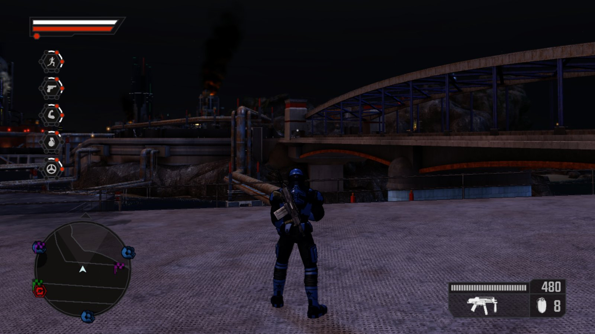
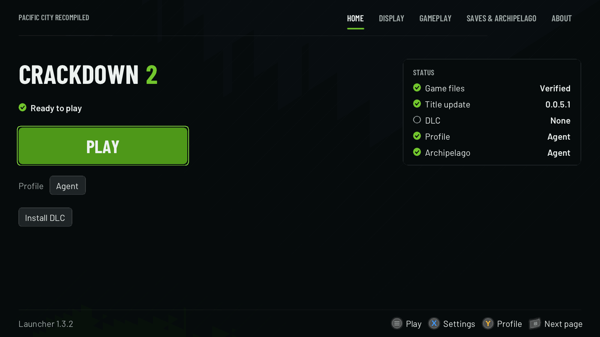
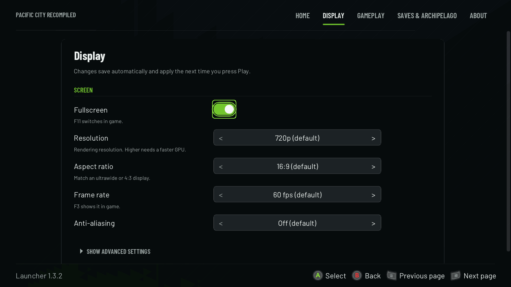
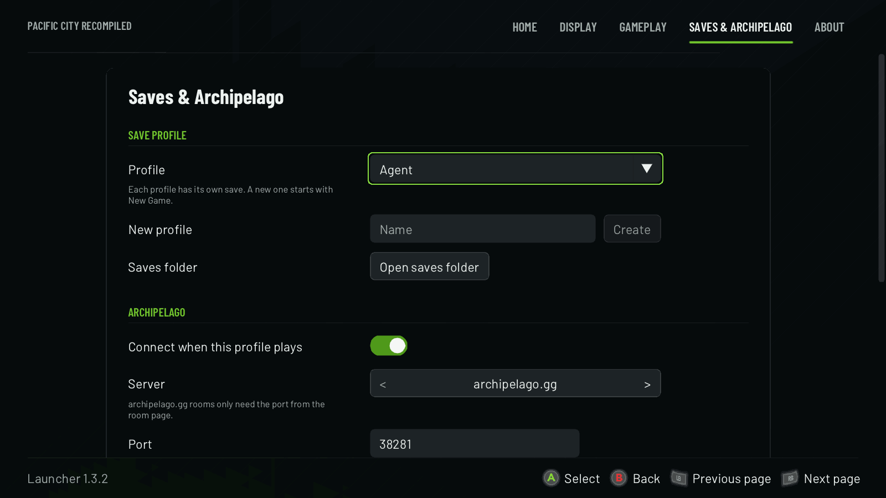
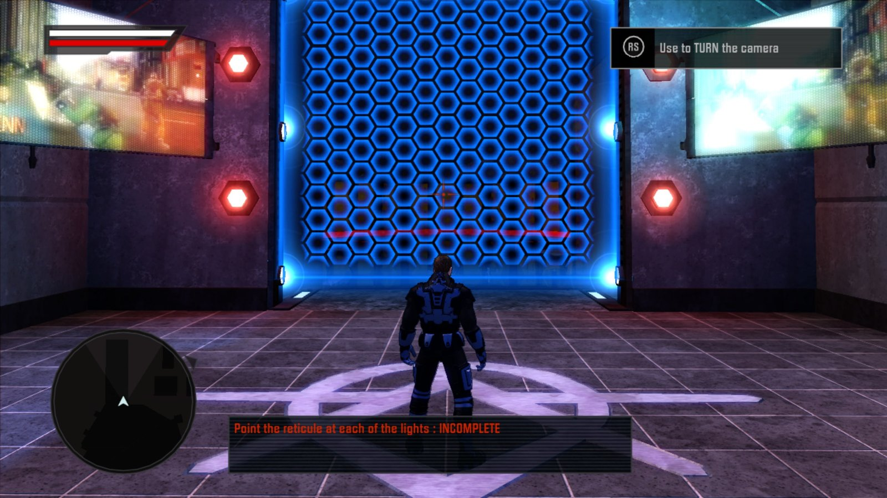

<div align="center">

# Crackdown 2 Recomp

**Crackdown 2 (Xbox 360, 2010), recompiled to run natively on Windows PC.**

60 fps · up to 4K · controller-friendly launcher · DLC · Archipelago

[](https://github.com/pacific-city-recompiled/crackdown-2-recomp/releases/latest)
[](https://github.com/pacific-city-recompiled/crackdown-2-recomp/blob/main/LICENSE)
[](#requirements)

**[Download 1.0.1](https://github.com/pacific-city-recompiled/crackdown-2-recomp/releases/latest)** ·
**[Report a problem](https://github.com/pacific-city-recompiled/crackdown-2-recomp/issues)** ·
**[Crackdown 1](https://github.com/pacific-city-recompiled/crackdown-recomp)**



</div>

Crackdown 2 Recomp is an unofficial native PC port of Crackdown 2. It is not an emulator: the game's
Xbox 360 code is translated ahead of time (static recompilation) into a Windows program, then fixed and
extended for modern PCs. It shares its engine work with [Crackdown Recomp](https://github.com/pacific-city-recompiled/crackdown-recomp).
A launcher installs the game, its title update and DLC from **your own** files, checks every file,
and works fully with a controller.

> [!IMPORTANT]
> No game files are included. You need your own dump of the **Crackdown 2 World multi-language disc**
> and **title update 0.0.5.1**. DLC is optional.

## Install

### With Quiver Launcher

Find **Crackdown 2** in [Quiver](https://quiverlauncher.com), press **Get**, then **Play**. Quiver
downloads and updates the game; it opens the Crackdown 2 launcher, which walks you through the first run.

### From the release ZIP

| Download | Use it if |
|---|---|
| `Crackdown2-Windows-1.0.1.zip` | You want just Crackdown 2. Run `Crackdown2Recomp.exe`; the game sits in `cd2\` next to it. This is the package Quiver installs. Extract over 1.0.0 to update; your game files and saves stay. |
| `Crackdown2Recomp-1.0.1.zip` | You play from the combined [Crackdown launcher](https://github.com/pacific-city-recompiled/crackdown-recomp/releases/latest). You don't need to download this by hand: pick **CRACKDOWN 2** in its header and choose **Download runtime**, and it updates itself after that. |
| `crackdown2.apworld`, `Crackdown2.yaml` | Archipelago world and a sample player file (see below). |

Get them from the [latest release](https://github.com/pacific-city-recompiled/crackdown-2-recomp/releases/latest)
and extract the **whole** ZIP into a folder you can write to (for example `Documents\Crackdown2`, not `Program Files`).

## First run

A short guided setup takes you through three steps:

1. **INSTALL GAME:** pick your disc image or an extracted game folder. The launcher extracts it and checks every
   file against the supported version.
2. **INSTALL TITLE UPDATE:** pick the title update 0.0.5.1 package (`TU_16L625S_...`, from a console's
   `Content\0000000000000000\4D5308BC\000B0000`). Crackdown 2 needs it to run.
3. **INSTALL DLC** (optional): the Toy Box Pack, Deluge Pack and Pre-Order Armor packages (from
   `...\4D5308BC\00000002`, keep the original file names). Every save profile can use them.

When the status reads **Ready to play**, press **PLAY**.



## Controller shortcuts

The whole launcher works with a controller, so it is comfortable from the couch, in Big Picture or in Quiver.

| Button | Does |
|---|---|
| **Start** | Play (from the home page) |
| **X** | Open Settings |
| **Y** | Pick the save profile |
| **LB / RB** | Previous / next page |
| **D-pad / left stick** | Move; **left / right** changes a setting in place |
| **A / B** | Select / back |
| **LT + RT** (or F11) | Switch the launcher between fullscreen and a window |

**A** on a text box opens an on-screen keyboard (X deletes, Y types a space, Start finishes). Under
**Gameplay → Advanced** you can open the launcher fullscreen and start the game right away after a
3-second countdown (any button stops it). The launcher hides while you play and comes back when the game closes.

## Settings

Settings save on their own and apply the next time you press Play. The launcher already shows aspect ratio,
camera speed and 120 / 144 fps for Crackdown 2; the game supports them from the next release. Rare and debug options sit under each
page's **Show advanced settings**.

| Page | What's there |
|---|---|
| **Display** | Fullscreen, resolution (720p up to 4K), frame rate (60 fps default, 30 fps for the original timing), anti-aliasing |
| **Gameplay** | Language, skip intro logos, mouse and keyboard |
| **Saves & Archipelago** | Save profiles, the saves folder (`Documents\crackdown2`), portable mode, Archipelago connection |
| **About** | Versions, verify game files, logs folder, copy system info |

<table>
  <tr>
    <td width="50%"></td>
    <td width="50%"></td>
  </tr>
  <tr>
    <td align="center"><sub>Display</sub></td>
    <td align="center"><sub>Saves & Archipelago</sub></td>
  </tr>
</table>

## Archipelago randomizer (experimental)

Join an [Archipelago](https://archipelago.gg) multiworld (Archipelago 0.6.8 or newer). Agility orbs, and
optionally hidden orbs and audio logs, are checks. Your Progressive skills (Agility, Driving, Explosives,
Strength, Firearms) come from the multiworld instead of orbs and experience. **Goal:** reach the top level
in all five skills.

1. **Player file:** double-click `crackdown2.apworld` (or copy it into Archipelago's `custom_worlds` folder),
   then make your YAML with the **Options Creator** or edit `Crackdown2.yaml`. Whoever generates the seed
   needs the apworld too.
2. **Profile:** on **Saves & Archipelago**, create a save profile for the seed (one profile per seed; a save is
   bound to the first seed it connects to). With a controller, **Create a profile for this seed** opens the keyboard.
3. **Connect:** turn on **Connect when this profile plays**. Keep **archipelago.gg** and type just the **port**
   from your room page (the number after `archipelago.gg:`, for example `38281`), or pick **Custom address** for
   any other `host:port`. Enter your slot name and password (if any).
4. Press **PLAY** and start a new game. The game connects by itself; there is no separate client window.

More detail: [setup guide](https://github.com/pacific-city-recompiled/crackdown-2-recomp/blob/main/archipelago/crackdown2/docs/setup_en.md).

## Screenshots



## Requirements

| | |
|---|---|
| OS | Windows 10 or 11, 64-bit |
| CPU | x64 with AVX2 and FMA3 (most Intel since 2013, AMD since 2015) |
| GPU | DirectX 12 |
| Runtime | [Microsoft Visual C++ x64 Redistributable](https://aka.ms/vs/17/release/vc_redist.x64.exe) |
| Game | Your own Crackdown 2 World multi-language disc and title update 0.0.5.1; DLC optional |

## Troubleshooting

- **Crash right after the Xbox 360 logo at a resolution above 720p:** fixed in 1.0.1. Update (Quiver does this
  for you, or extract the new ZIP over your install); 1440p and 4K now work.
- **"Title update needed":** Crackdown 2 doesn't start without title update 0.0.5.1. Use **INSTALL TITLE UPDATE**
  on the home page.
- **"Windows protected your PC" (SmartScreen):** the files aren't code-signed. Click **More info → Run anyway**.
- **"This app can't run on your PC" / `0xc0e90002`:** Windows Smart App Control blocks unsigned programs and has no
  per-app exception. The only way past it is turning Smart App Control off.
- **The launcher says a file doesn't match:** only the World multi-language disc is supported (see the hashes below).
- **Something else:** on **About**, use **Open logs folder** and **Copy system info**, and open an
  [issue](https://github.com/pacific-city-recompiled/crackdown-2-recomp/issues) with the newest `crackdown2_NNN.log`.

## For developers

<details>
<summary>Supported files, building from source, repository layout</summary>

The code is built on the [ReXGlue SDK](https://github.com/rexglue/rexglue-sdk) (`sdk/`, pinned to v0.10.0) and
reuses the Crackdown 1 pipeline. **No game data and no generated code is in this repository.**

| Item | Detail |
|---|---|
| Disc | World multi-language ISO (XGD2), 99 files. `default.xex` sha256 `8959c449e382661d29b8ea479c685f506cd5bd3eca40b3d73a51cc10f281069f` |
| Title update | `default.xexp` (STFS package, media 18B6CD67), sha256 `a5e49fc1ff7f6f65e6f95a7b5c4b9392bb9e38674d1237ac0e2f0149d05929d7`. The SDK applies it to the XEX: 0.0.0.1 -> 0.0.5.1 |
| DLC | Toy Box Pack, Deluge Pack, Pre-Order Armor (title 4D5308BC, type 2) |

All addresses target the **title-update-patched** binary (the update is a full rebuild, so disc-only addresses
differ). The recomp always runs with the update applied.

**Prepare a game folder by hand** (the launcher does this for players):

```
python -I tools/xiso_extract.py "<disc>.iso" game          # XDVDFS extractor, no extra tools
python -I tools/stfs_extract.py "<title update package>" tu  # checks every block SHA-1
copy tu\default.xexp game\                                   # SDK picks the sibling .xexp
xcopy /E tu game\TU\                                         # the game also reads D:\TU\...
python -I tools/install_dlc.py "%USERPROFILE%\Documents\crackdown2" "<DLC package>" ...
```

**Build and run (Windows):**

1. VS 2022 (x64 tools), LLVM/Clang 20, CMake, Ninja. Developer Mode on (SDK dependencies use symlinks).
2. Build and install the SDK with `patches/sdk/*.patch` applied (`tools/apply-sdk-patches.sh`, see `docs/playbook.md`).
3. `build-cd2.bat [sdk-install-dir]` runs codegen and builds `crackdown2/out/build/win-amd64-release/crackdown2.exe`.
4. Run from that folder: `crackdown2.exe --game_data_root=<game> --update_data_root=<tu> --gpu_plugin=xenos`.

| Path | What's there |
|---|---|
| `crackdown2/` | Game hooks and runtime fixes |
| `patches/sdk/` | SDK fixes |
| `archipelago/crackdown2/` | The Archipelago world |
| `docs/` | `re-notes.md` (reverse-engineering notes), `playbook.md`, plans and handoffs |

The launcher lives in its own repository,
[pacific-city-recompiled-launcher](https://github.com/pacific-city-recompiled/pacific-city-recompiled-launcher).

</details>

## Legal

Crackdown 2 Recomp is an unofficial fan project. It is not affiliated with or endorsed by Microsoft, Xbox Game
Studios or Ruffian Games. Crackdown 2 and all related names and assets belong to their owners. No game data is
distributed; you must own the game and supply your own disc, title update and DLC.

The source code is released under the license in
[LICENSE](https://github.com/pacific-city-recompiled/crackdown-2-recomp/blob/main/LICENSE). Third-party code
keeps its own notices.
